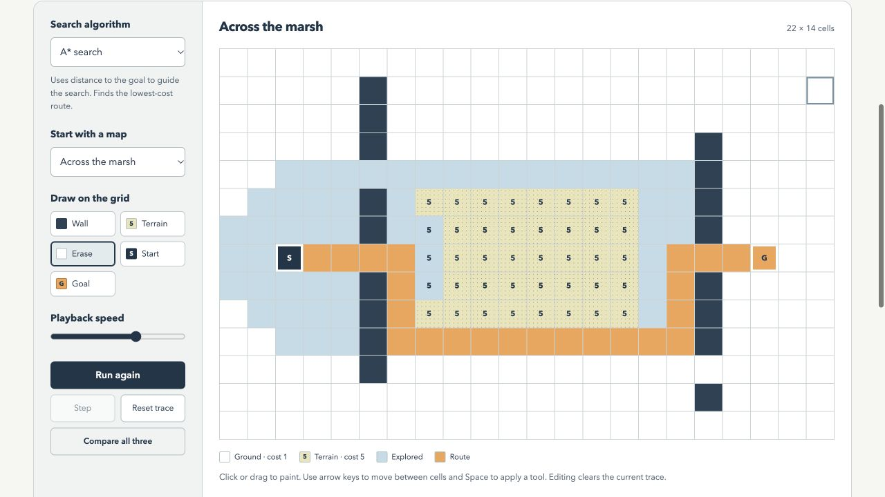

# Pathfinding Lab

A browser workbench for understanding **BFS, Dijkstra, and A\*** through the routes they choose. Draw walls, add expensive terrain, move the endpoints, and replay a search cell by cell.

The default map makes the tradeoff concrete: BFS takes **17 steps with a travel cost of 49**. Dijkstra and A* take **23 steps with a cost of 23**. A shorter path is not always a cheaper trip.



## Run locally

No build, account, package install, or API key is required.

```sh
git clone https://github.com/farisgomaa8-ops/pathfinding-lab.git
cd pathfinding-lab
python3 -m http.server 8000
```

Open [localhost:8000](http://localhost:8000). Serve the folder over HTTP; opening `index.html` directly can block ES module loading in browsers.

## Try it

1. Leave **Across the marsh** selected and press **Compare all three**.
2. Compare travel cost with route steps. The orange cells show the selected algorithm’s route; blue cells show the rest of its explored area.
3. Select **Breadth-first search** and press **Run search**. Pause it or use **Step** to inspect the expansion order.
4. Paint walls or terrain, or move the start and goal. Editing a map clears its old results.
5. Try **No way through** for an unreachable goal, then erase a wall to open a route.

The presets are deterministic. Reloading a preset restores exactly the same map.

## What it includes

- Pure search functions separated from the interface, with deterministic tie breaking.
- BFS for the fewest steps, Dijkstra for the lowest cost, and A* with a Manhattan-distance heuristic.
- A 22 × 14 editable grid with ground (cost 1), terrain (cost 5), and impassable walls.
- Run, pause, continue, single-step playback, and a comparison view.
- Mouse/touch painting and keyboard navigation: focus the grid, use arrow keys, then press Space or Enter to apply the selected tool. Home and End move to the edges of a row.
- On narrow phones, swipe the strip below the grid to move across the map; touching cells paints instead of scrolling.
- Visible focus states and a reduced-motion mode that shows the completed search immediately. Single-step inspection remains available.
- No runtime dependencies, analytics, network requests, or browser storage. Maps stay in memory and reset when the page reloads.

## Test

Node.js 18 or newer is required only for tests. CI runs on Node.js 22.

```sh
npm test
```

The 12 tests check boundary neighbors, weighted routes, unreachable goals, start-equals-goal behavior, invalid input, reproducibility, and non-mutation. They also compare Dijkstra and A* against an independent repeated-relaxation oracle on **80 seeded weighted grids**, and check BFS against the same oracle with all walkable costs set to one.

Tests exercise the algorithm layer. A useful manual interface check is to run/pause/continue, step, change presets, paint while a trace is present, use keyboard tools, and compare results on a narrow screen.

## Rules behind the results

Movement is allowed up, down, left, and right. The cost of a move is the cost of **entering the destination cell**. The starting cell costs zero. Wall cells cannot be visited. “Cells explored” counts expanded cells, including the start and the goal when reached; it does not count every item ever placed in the search frontier.

BFS ignores terrain while searching, although the interface still reports the actual cost of its chosen path. Dijkstra and A* both minimize travel cost. A* can expand fewer cells on many layouts, but the app makes no universal speed claim: its performance depends on the map and tie breaking.

See [the algorithm notes](docs/algorithms.md) for correctness assumptions and implementation choices.

## Project layout

```text
index.html                 Interface and content
styles.css                 Responsive workbench styling
src/algorithms.js          Validation, frontier, and pure search functions
src/presets.js             Reproducible map layouts
src/app.js                 Editing, playback, and comparison rendering
test/algorithms.test.js    Unit tests and independent reference checks
docs/algorithms.md         Model, tradeoffs, and limitations
.github/workflows/test.yml Automated algorithm checks
```

## Scope

This is an educational grid-search tool. It does not model real roads, traffic, diagonal movement, negative costs, multi-agent planning, or changing obstacles during a search. The interface uses a fixed-size grid; the algorithm functions accept other dimensions. The browser view requires a modern browser with ES module and Pointer Events support.

## License

[MIT](LICENSE).
